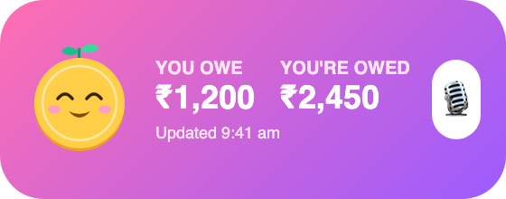

  

<h1 align="center">Fin</h1>

<b>Split money with friends by just saying what happened.</b> 
An Android app with a team of AI agents and a coin-shaped mascot that reacts to every step.

  

> **[Try the live demo](https://saipranav13188.github.io/fin-showcase/)**, no sign-up needed.
>
> This page shows the project. The source code is kept in a private repository and is not available for
> download. See [LICENSE](LICENSE).

## What it does

You type or say something like *"I paid 2400 for dinner, Rahul skipped drinks"*. Fin drafts the split, tracks
who owes whom, writes polite reminders and helps you settle up through your own UPI app.

Fin never holds or moves money. Paying opens GPay, PhonePe or Paytm with the details already filled in.

### Features

- **Groups with friends.** Add people by name or share an invite link. Every expense splits equally by default,
  or by exact amounts, shares, percentages or line items.
- **Talk to it.** Text or voice in English, Hindi, Hinglish or Telugu becomes a draft expense.
- **Scan a bill.** A photo becomes line items, tax and tip, ready to split.
- **Settle up.** It works out the fewest payments that clear a group and opens your UPI app with them.
- **Group chat.** Type "I paid 600 for pizza" in the chat and it becomes an expense.
- **Import payments.** Bring in GPay, PhonePe, Paytm and bank statements as a private spending ledger.
- **Reminders.** Rent, EMI and subscription reminders, plus friendly nudges in the tone and language you choose.
- **Insights.** Ask questions about your own spending in plain language.
- **Savings goals, a home-screen widget, offline mode and app lock.**

## The agent system

Nine agents sit behind one orchestrator built as a LangGraph graph. Each agent can only read data and produce a
**draft**. Nothing is saved, sent or paid until you confirm.

| Agent | Job |
|---|---|
| Orchestrator | Routes a message to the right agent |
| Expense Parser | Text or voice to a draft expense |
| Receipt Reader | A bill photo to line items, tax and tip |
| Split Advisor | "Rahul skipped drinks" to who shares which item |
| Settle-up Planner | The fewest payments that settle a group, with UPI links |
| Nudge Writer | A friendly reminder in the chosen tone and language |
| Insights | Answers questions with read-only queries over your own records |
| Safety Guard | Checks every payment: new UPI ID, unusual amount, duplicate, scam phrases |
| Monitor | Daily job for bill and subscription reminders |

### Safety rules, enforced in code

- **Draft, then confirm.** There is a single write path, and it re-checks every AI draft with the same rules as an
  expense typed by hand.
- **No invented data.** Any person or amount the AI can't trace back to your message is removed, and the gap
  becomes a question for you.
- **Prompt-injection defence.** Text from users, receipts and friends is treated as data, never as instructions.
- **Budgets.** Every request has a step limit, a token budget, a timeout and retries.
- **Works offline.** Every agent has a rule-based fallback for when the model is unavailable.
- **Isolated insights.** AI-written queries run in a throwaway database that holds only your own rows, and only
  read queries are allowed.
- **Audit log.** Every agent run is recorded with its tool calls, tokens and latency.

The Settle-up Planner and the Safety Guard are deterministic on purpose: anything that decides where money goes
gives the same answer every time.

### Quality gate

An evaluation set of 64 expense cases (typos, "2.5k", Hinglish, Hindi and Telugu script, missing amounts, unknown
names, prompt injection), plus intent and safety cases, runs in CI. A change fails the build if field accuracy drops
below 95% or the AI invents a single field. On the live model the set scores **99.3% field accuracy with zero
hallucinated fields**.

## Tech stack

| Part | Built with |
|---|---|
| App | Expo (React Native), TypeScript, Expo Router, Reanimated, TanStack Query |
| API | Python, FastAPI, SQLAlchemy, Alembic |
| AI | LangGraph agents on Google Gemini, with rule-based fallbacks |
| Data | PostgreSQL (Supabase), with daily backups and a tested restore |
| Ops | Docker on Render, GitHub Actions CI, Sentry crash reports |

Money is stored in whole paise and split with the largest-remainder method, so every share adds up to the exact
total.

## Privacy

Secrets live only in environment variables and are never committed. Fin never asks for your UPI PIN and never
touches your money.

## Contact

Want to see the code or a demo? Open an issue on this repository.

---

© 2026. All rights reserved. The name Fin, the mascot and the designs are original work.
